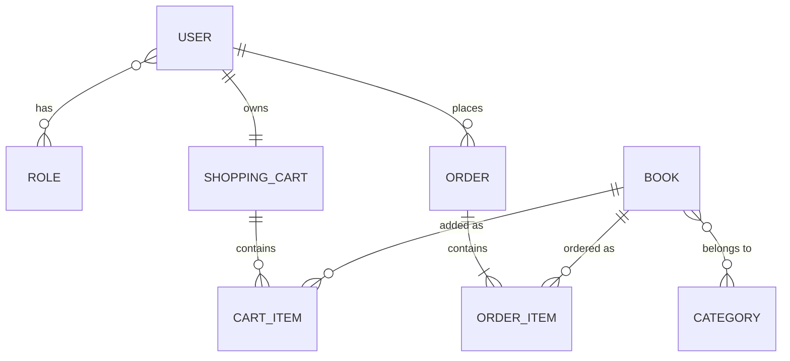

# 📚 Book Store API

A backend for an online bookstore: customers browse and search the catalog, fill a
shopping cart and place orders, while administrators manage books, categories and
order statuses. The API is secured with JWT and role-based access, documented with
Swagger and fully containerized with Docker, so it can be started with one command.

I built this project during the Mate Academy Java course to practice building a
production-style REST API with Spring Boot, from database migrations to security.

## Tech Stack

| Category      | Technologies                                |
|---------------|---------------------------------------------|
| Language      | Java 17                                     |
| Framework     | Spring Boot 3.5, Spring Web                 |
| Security      | Spring Security, JWT (jjwt)                 |
| Persistence   | Spring Data JPA, Hibernate, MySQL 8.4       |
| Migrations    | Liquibase                                   |
| Mapping       | MapStruct, Lombok                           |
| Validation    | Jakarta Bean Validation                     |
| API docs      | Swagger UI (springdoc-openapi)              |
| Testing       | JUnit 5, Mockito, Spring Boot Test, H2      |
| Build & tools | Maven, Checkstyle                           |
| DevOps        | Docker, Docker Compose, GitHub Actions (CI) |

## API Endpoints

### 🔐 Authentication
| Method | Endpoint                 | Description       | Access |
|--------|--------------------------|-------------------|--------|
| POST   | `/api/auth/registration` | Register new user | Public |
| POST   | `/api/auth/login`        | User login        | Public |

Login returns a JWT token. Send it in the `Authorization: Bearer <token>` header
to access all other endpoints.

### 📚 Books
| Method | Endpoint             | Description                               | Access      |
|--------|----------------------|-------------------------------------------|-------------|
| GET    | `/api/books`         | Get all books (paginated and sorted)      | USER, ADMIN |
| GET    | `/api/books/{id}`    | Get book by id                            | USER, ADMIN |
| GET    | `/api/books/search`  | Search books by parameters (paginated)    | USER, ADMIN |
| POST   | `/api/books`         | Create a book                             | ADMIN       |
| PUT    | `/api/books/{id}`    | Update a book                             | ADMIN       |
| DELETE | `/api/books/{id}`    | Delete a book (soft delete)               | ADMIN       |

Pagination and sorting work through query parameters, for example
`/api/books?page=0&size=10&sort=price,desc`.
Search combines filters dynamically using JPA Specifications, for example
`/api/books/search?titles=Java&authors=Bloch`.

### 🏷️ Categories
| Method | Endpoint                     | Description                               | Access      |
|--------|------------------------------|-------------------------------------------|-------------|
| GET    | `/api/categories`            | Get all categories (paginated and sorted) | USER, ADMIN |
| GET    | `/api/categories/{id}`       | Get category by id                        | USER, ADMIN |
| GET    | `/api/categories/{id}/books` | Get all books in a category               | USER, ADMIN |
| POST   | `/api/categories`            | Create a category                         | ADMIN       |
| PUT    | `/api/categories/{id}`       | Update a category                         | ADMIN       |
| DELETE | `/api/categories/{id}`       | Delete a category                         | ADMIN       |

Books and categories are linked many-to-many: one book can belong to several categories.
When books are listed inside a category, the response uses a lighter DTO without
category ids, since the category is already known from the request.

### 🛒 Shopping Cart
| Method | Endpoint                             | Description                     | Access |
|--------|--------------------------------------|---------------------------------|--------|
| GET    | `/api/cart`                          | Get the current user's cart     | USER   |
| POST   | `/api/cart`                          | Add a book to the cart          | USER   |
| PUT    | `/api/cart/cart-items/{cartItemId}`  | Update the quantity of an item  | USER   |
| DELETE | `/api/cart/cart-items/{cartItemId}`  | Remove an item from the cart    | USER   |

The cart always belongs to the logged-in user: the user is taken from the JWT token,
so no user id is passed in the URL and nobody can access someone else's cart.

> The admin account has no cart. To test the cart and orders, register a regular user.

### 📦 Orders
| Method | Endpoint                                | Description                          | Access |
|--------|-----------------------------------------|--------------------------------------|--------|
| POST   | `/api/orders`                           | Create an order from the cart        | USER   |
| GET    | `/api/orders`                           | Get order history (paginated)        | USER   |
| GET    | `/api/orders/{orderId}/items`           | Get all items of an order            | USER   |
| GET    | `/api/orders/{orderId}/items/{itemId}`  | Get a specific item of an order      | USER   |
| PATCH  | `/api/orders/{id}`                      | Update order status                  | ADMIN  |

An order is built from the user's current shopping cart: every cart item becomes an
order item. Users see only their own orders, while the admin manages order statuses.

## Database Schema



## Running with Docker

### Prerequisites
- [Docker Desktop](https://www.docker.com/products/docker-desktop/)

### 1. Configure environment variables
Copy the template and fill in your own values:

```bash
cp .env.template .env
```

| Variable                | Description                                                                                          | Example           |
|-------------------------|------------------------------------------------------------------------------------------------------|-------------------|
| `MYSQLDB_USER`          | Database user. Must be `root`, because the password below is set for the root user                   | `root`            |
| `MYSQLDB_ROOT_PASSWORD` | Password for the MySQL root user                                                                     | your own password |
| `MYSQLDB_DATABASE`      | Database name                                                                                        | `book_store`      |
| `MYSQLDB_LOCAL_PORT`    | MySQL port on your machine. Use a free port (not `3306` if you already have MySQL installed locally) | `3307`            |
| `MYSQLDB_DOCKER_PORT`   | MySQL port inside the container                                                                      | `3306`            |
| `SPRING_LOCAL_PORT`     | Application port on your machine                                                                     | `8088`            |
| `SPRING_DOCKER_PORT`    | Application port inside the container                                                                | `8080`            |
| `JWT_SIGNING_KEY`       | Secret key for signing JWT tokens, at least 32 characters                                            | see below         |

Generate a secure JWT key:

```powershell
# Windows (PowerShell)
[Convert]::ToBase64String((1..48 | ForEach-Object { Get-Random -Maximum 256 }))
```

```bash
# macOS / Linux
openssl rand -base64 48
```

> **Never commit the `.env` file.** It is listed in `.gitignore`.

### 2. Start the application

```bash
docker compose up --build
```

The first start takes a few minutes: Docker downloads the images and MySQL initializes the database. Liquibase creates the tables automatically.

### 3. Open the API
Swagger UI: `http://localhost:<SPRING_LOCAL_PORT>/api/swagger-ui/index.html`
(e.g. `http://localhost:8088/api/swagger-ui/index.html`)

**Default admin account** (created automatically by Liquibase on first start):
- Email: `admin@bookstore.com`
- Password: `admin12345`

To get a regular user, register via `POST /api/auth/registration`.
New users receive the `USER` role.

> These credentials are for local testing only.

### 4. Stop the application

```bash
docker compose down
```

## Running tests

```bash
mvn clean verify
```

Tests use an in-memory H2 database, so Docker is not required.
This command also runs Checkstyle.

## Challenges

**Role prefixes in Spring Security.**
`hasRole('ADMIN')` silently checks for the authority `ROLE_ADMIN`, so mixing prefixed
and unprefixed role names led to unexpected 403 errors. I stored roles in an enum that
already contains the `ROLE_` prefix and kept `@PreAuthorize` expressions without it.

**Creating the admin user without hardcoded ids.**
The admin must be linked to the `ROLE_ADMIN` role, but ids differ between databases.
In the Liquibase changeset I used `valueComputed` with subqueries that look up the user
and the role by their unique names, so the migration works on any fresh database.

**The application started before the database was ready.**
On the first Docker start the app container tried to connect while MySQL was still
initializing. I added a healthcheck to the database service and made the app start
only when the database reports it is healthy.

**Port conflict with a local MySQL.**
Port 3306 was already taken by MySQL installed on my machine. I moved all ports into
`.env`, so the host port can be changed (e.g. to 3307) without touching the code.
